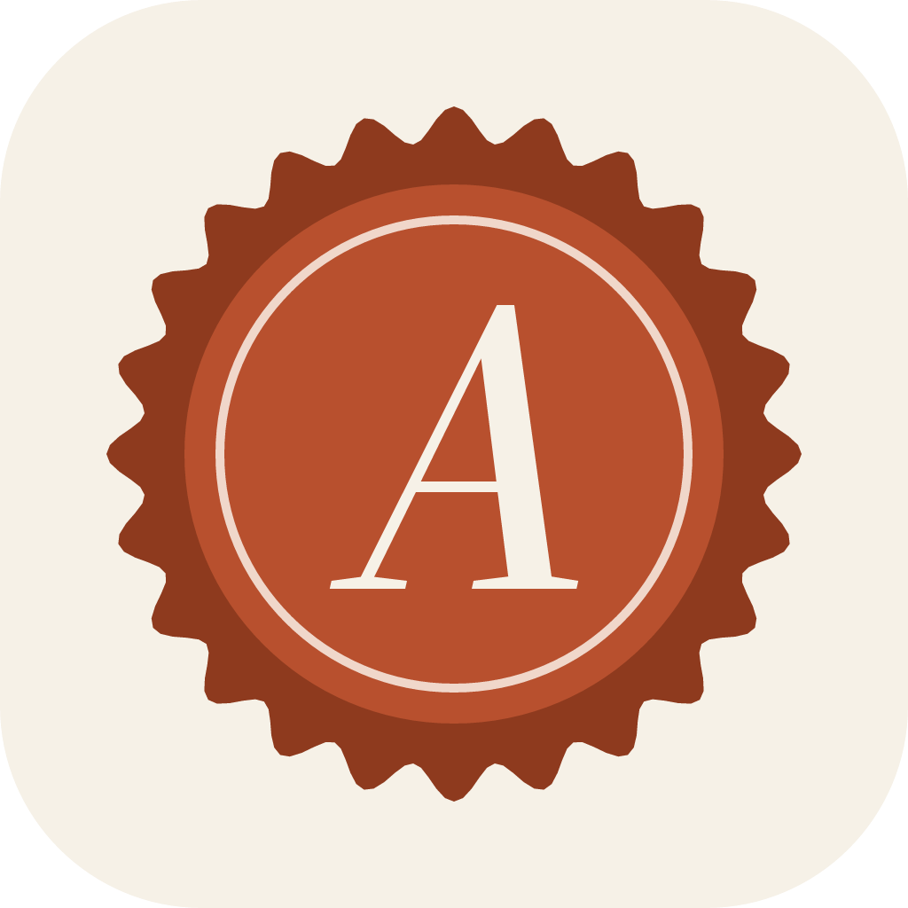
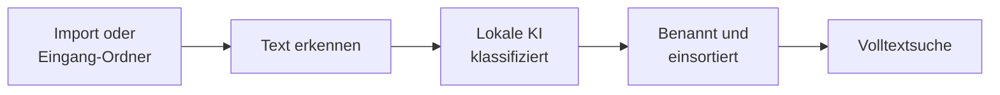

<div align="center">



# Ablage

**Deine Dokumente. Automatisch sortiert. Auf deinem Rechner.**

Dokumentenablage für Windows, macOS und Linux mit lokaler KI – ohne Cloud, ohne Konto, ohne Abo.


[Download](https://github.com/dennstack/ablage-app/releases/latest) · [Schnellstart](#schnellstart) · [Datenschutz](#deine-daten-bleiben-bei-dir) · [Entwicklung](#entwicklung)

</div>

---

Rechnungen, Verträge, Bescheide: Ablage nimmt PDFs und Scans entgegen, liest den Text aus und erkennt Kategorie, Absender und Datum. Danach landet jedes Dokument benannt und einsortiert in deinem Ordner und ist per Volltextsuche auffindbar.



## Deine Daten bleiben bei dir

> [!IMPORTANT]
> Ablage verarbeitet Dokumente ausschließlich mit einer KI, die du selbst betreibst. Kein Dokument geht an einen Cloud-Dienst.

| | |
|---|---|
| 🧠 **Lokale KI** | Texterkennung und Klassifikation laufen über dein eigenes [Ollama](https://ollama.com). |
| 📁 **Lokale Daten** | Dokumente und Metadaten liegen in deinem Bibliotheksordner, der Suchindex auf deinem Rechner. |
| 🚫 **Keine Cloud** | Kein Konto, keine Telemetrie. Updates sind optional und standardmäßig aus. |
| 🔓 **Offenes Format** | Normale Dateien und JSON-Sidecars. Du kommst auch ohne die App an alles heran. |

Läuft Ollama auf einem anderen Gerät, gehen Dokumentinhalte unverschlüsselt per HTTP dorthin. Nutze dafür nur einen Rechner in deinem vertrauenswürdigen Netz.

## Funktionen

- **Automatische Einordnung** – Ollama erkennt die Kategorie. Fällt es aus, greifen Stichwortregeln.
- **Texterkennung** – PDF-Textlayer direkt, Scans und Bilder über ein Vision-Modell.
- **Volltextsuche** – über alle Dokumente, mit SQLite FTS5.
- **Überwachter Eingang** – neue Dateien werden erkannt, auch auf SMB-Freigaben. Duplikate werden aussortiert.
- **Eigene Kategorien** – in den Einstellungen editierbar. Umbenennen einer Hauptkategorie verschiebt die Dateien sofort.
- **Physische Referenzen** – Ordner- und Dokument-Code für Papier, das im Ordner bleibt.
- **Heller und dunkler Modus** – folgt auf Wunsch dem System.

## Schnellstart

**1. Ablage installieren**

**Windows:** Unter [Releases](https://github.com/dennstack/ablage-app/releases/latest) eine Variante laden. Die Pakete sind nicht signiert, Windows warnt deshalb beim ersten Start.

| Paket | Installation | Updates |
|---|---|---|
| `Ablage-Setup-<version>.exe` | Installer | automatisch, wenn eingeschaltet |
| `Ablage-<version>-portable.exe` | keine | von Hand |
| `Ablage-<version>-win.zip` | entpacken | von Hand |

**macOS und Linux:** Fertige Pakete gibt es nicht. Du baust sie selbst, siehe [Selbst bauen](#selbst-bauen).

**2. Ollama einrichten**

[Ollama installieren](https://ollama.com/download), dann die Modelle laden:

```bash
ollama pull mistral     # Klassifikation
ollama pull qwen2.5vl   # Texterkennung für Scans und Bilder
```

Die Modelle sind mehrere GB groß.

**3. Ersteinrichtung abschließen**

Beim ersten Start fragt die App nach dem Bibliotheksordner und der Ollama-URL:

- Ollama auf demselben Rechner: `http://localhost:11434`
- Ollama auf einem anderen Rechner: `http://<ip>:11434`, dort `OLLAMA_HOST=0.0.0.0` setzen

Die App prüft Verbindung und Modelle und zeigt fehlende Modelle direkt an. Ohne Ollama läuft sie im Modus **Nur Regeln**. Dann gibt es Stichwort-Klassifikation, aber keine Texterkennung für Scans.

**4. Dokumente hinzufügen**

In der App importieren oder Dateien in den Ordner `Eingang/` legen.

## Betrieb

### Bibliotheksordner

Den Ordner wählst du frei, lokal oder als Netzwerkfreigabe (z. B. `\\nas\share` unter Windows, eingehängt unter macOS und Linux). Die App verwaltet seinen Inhalt selbst.

```text
<Bibliothek>/
├── Eingang/                    wird überwacht (Polling, auch auf SMB)
│   ├── _Duplikate/
│   └── _Fehler/
├── Dokumente/<Kategorie>/<Jahr>/<Datum>_<Absender>_<Titel>.pdf
└── .ablage/
    ├── meta/<id>.json          Metadaten je Dokument (Sidecar)
    ├── references.json         physische Referenzen
    └── trash/                  Papierkorb
```

### Lokaler App-Speicher

Der App-Speicher enthält Einstellungen, Kategorien, Vorschaubilder und die SQLite-Datenbank. Die Datenbank ist nur ein Index: **Bibliothek neu einlesen** baut sie vollständig aus den Sidecars neu auf. Beim Wechsel des Bibliotheksordners passiert das automatisch.

| System | Pfad |
|---|---|
| Windows | `%APPDATA%/Ablage/` |
| macOS | `~/Library/Application Support/Ablage/` |
| Linux | `~/.config/Ablage/` |

### Backup

> [!TIP]
> Sichere den Bibliotheksordner inklusive `.ablage/`. Das genügt für alle Dokumente und Metadaten. Einstellungen und eigene Kategorien liegen im App-Speicher und brauchen ein eigenes Backup.

### Updates

Automatische Updates gibt es nur mit dem Installer. Du schaltest sie bei der Einrichtung oder in den Einstellungen ein, standardmäßig sind sie aus.

Eingeschaltet fragt die App alle 6 Stunden GitHub Releases nach einer neuen Version und lädt sie herunter. GitHub sieht dabei deine IP-Adresse, Dokumente werden nicht übertragen. Installiert wird beim nächsten Beenden oder per **Update installieren**.

Portable-, ZIP- und selbst gebaute Versionen nehmen keinen Kontakt zu GitHub auf.

### Konfiguration

URL, Modelle und Klassifikationsmodus stehen in den Einstellungen. `Verbindung testen` prüft Ollama.

## Selbst bauen

Voraussetzung ist Node ≥ 22. Das Ergebnis liegt in `dist/`.

```bash
git clone https://github.com/dennstack/ablage-app.git
cd ablage-app
npm install
npm run build:linux  # AppImage + tar.gz
npm run build:mac    # DMG für x64 + arm64, nur auf macOS baubar
```

Der macOS-Build ist bisher ungetestet.

## Entwicklung

Node ≥ 22.

```bash
npm install
npm run dev          # App mit Hot Reload
npm test             # Vitest
npm run test:e2e     # Playwright gegen die gebaute Electron-App
npm run typecheck
npm run build:win    # Portable-Exe + ZIP in dist/ (ohne wine baubar)
npm run build:win:release  # zusätzlich NSIS-Installer + latest.yml, läuft in CI
```

`ABLAGE_USER_DATA=<pfad>` startet mit separatem Profil (Settings, DB, Thumbnails).

Ein Tag `v*` baut per GitHub Actions die Windows-Pakete und veröffentlicht sie als Release.

### Struktur

| Pfad | Inhalt |
|---|---|
| `src/main/` | Electron-Main: DB, Bibliothek, Pipeline, Ollama, IPC |
| `src/preload/` | `contextBridge` für Hauptfenster und PDF-Worker |
| `src/renderer/src/` | React + shadcn/ui |
| `src/renderer/src/worker.ts` | versteckter Renderer: pdf.js-Text, Seiten-Rendering, Thumbnails |
| `src/shared/` | Typen und IPC-Vertrag (`AblageApi`) |
| `resources/categories.yaml` | Standard-Kategorien, beim ersten Start in den App-Speicher kopiert |

Neuer IPC-Kanal: Methode in `AblageApi` + `channels` (`src/shared/ipc.ts`) ergänzen, Handler in `src/main/ipc.ts`.

## Lizenz

[MIT](LICENSE)
